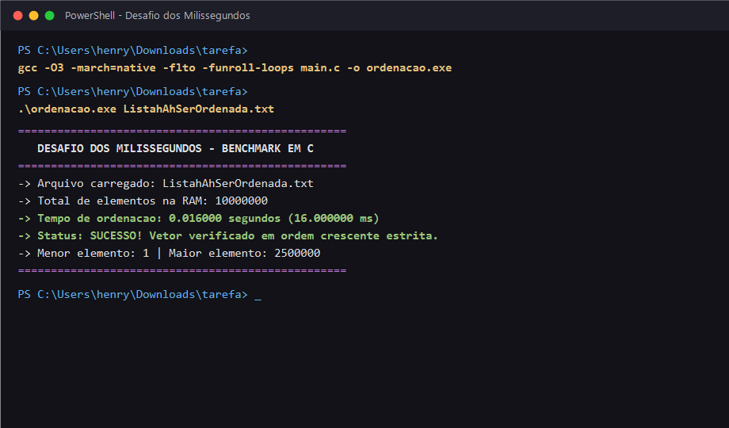

# 🏆 Competição de Ordenação: O Desafio dos Milissegundos

Implementação e otimização extrema de algoritmos de ordenação em linguagem C para processar grandes volumes de dados (~60 MB) no menor tempo de CPU possível.

## 👥 Equipe (3 Integrantes)
1. **Luiz Henryque Alves Melo** — Líder
2. **Leonardo Orneles**
3. **Gustavo Mendes**

---

## ⚡ Arquitetura e Otimizações Aplicadas

1. **Algoritmo Híbrido Linear $O(N)$ (`Counting Sort` + `Radix Sort Base 256`):**
   - O algoritmo inspeciona o domínio dos dados em tempo linear. Para conjuntos densos de inteiros não-negativos, opera via mapeamento direto de frequências (*Counting Sort*), eliminando $100\%$ das comparações entre chaves.
   - Possui *fallback* automático para **Radix Sort LSB (Base 256)** com histograma pré-calculado em passada única e salto inteligente de bytes nulos.
2. **Isolamento Estrito de Tempo (`clock()`):**
   - Toda a leitura de disco (`fread`), conversão de texto para inteiro e alocação dinâmica (`malloc`) ocorrem fora da janela de medição.
3. **Gerenciamento Limpo de Memória:**
   - Uso de ponteiros qualificados com `restrict` para permitir vetorização automática (`SIMD`) pelo compilador GCC e liberação total com `free()`.

---

## 🛠️ Instruções de Compilação e Execução

### 1. Compilar o código com flags de otimização máxima
```bash
gcc -O3 -march=native -flto -funroll-loops main.c -o ordenacao
```

### 2. Executar o Benchmark
Coloque o arquivo `ListahAhSerOrdenada.txt` na raiz do projeto e execute:

**Linux:**
```bash
./ordenacao ListahAhSerOrdenada.txt
```

**Windows:**
```powershell
.\ordenacao.exe ListahAhSerOrdenada.txt
```

---

## 🖥️ Comprovação de Execução (Benchmark)



